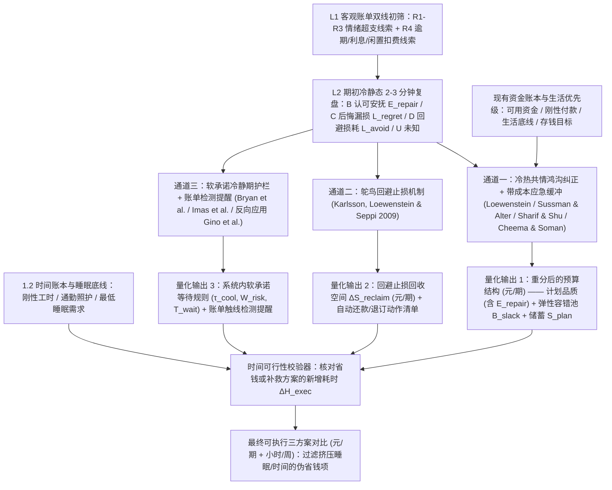

# 输入指标研究（一）：「情绪」模块重构规范与决策连接方案（定稿基线 v1.0）

> **归档说明（2026-11-25）**：本文件同步自 Antigravity「情绪板块」对话中的定稿基线 v1.0。当前状态为研究设计初步定稿；参数、测量表现与实际效果的待验证事项见第六节。本次保留原文内容，仅将云端文件链接调整为仓库内链接。

> **适用范围**：本规范聚焦[生活开销与储蓄分配研究进展](./budget-allocation-progress.md)中的第一个输入方向——**情绪**，直接替代此前停滞的“即时焦虑自报 $\rightarrow$ 复核弹窗时机（JITAI）+ 生理信号辅助”方案，并同步打通与 [1.2 模型规范](../v1.2/MODEL_SPEC.txt)中**每周时间约束（副输出 $\Delta H_{\text{exec}}$）**的接口。其余输入维度（健康、人际关系、认知等）在本轮保持开放，后续逐项独立推进。
>
> **证据标记沿用** [候选指标与决策关系表](./candidate-indicators.md)：`账本`、`测量`、`机制`、`代码`、`待验`。

---

## 核心定位收束

**情绪模块的新定位是：以历史账单中的两类客观行为痕迹（情绪超支线索 R1–R3 与情绪回避损耗线索 R4）为初筛、以规划期初一次性 2–3 分钟冷静态标定为校准，将情绪对个人资金账本的实质影响转化为三类可量化输出：**

1. **预算结构重分（元/期）**：显式保留用户认可的情绪安抚留白 $E_{\text{repair}}$，并将事后后悔的情绪超支漏损 $L_{\text{regret}}$ 转化为有界、带小成本的**情绪弹性应急容错池 $B_{\text{slack}}$**（未用自动转储蓄）；
2. **情绪回避止损清单（元/期）**：将确认为拖延/回避账单导致的逾期违约金、临时循环利息与忘取消闲置扣费（$L_{\text{avoid}}$）转化为**直接可回收储蓄空间 $\Delta S_{\text{reclaim}}$** 与低摩擦防遗漏动作（不划入容错池）；
3. **软承诺冷静期护栏与检测提醒（元、小时）**：诚实界定外部工具不拦截第三方免密支付，在系统内修改长期计划前提供**软承诺延迟护栏**，并对触及风险时段、金额阈值、容错池预警线或新增 R4 扣费的实际记录触发**非指责性检测提醒**；同时对任何“以时间换金钱”的补救/省钱方案同步校验**每周新增执行时间 $\Delta H_{\text{exec}}$（小时/周）**。

与原停滞方案的三项明确决断：

- **正式终止（结项归档）**：关闭穿戴设备生理信号（HR / RMSSD / SCL）估计焦虑的辅助路线，保留既有 WESAD 核验报告作为否定性实证依据。
- **明确放弃**：不再将“开心/难过/焦虑/生气”四项情绪作为每日或每次预算比较前的必填量表。
- **重构推进**：从“只决定何时弹复核窗口（对金额零影响）”升级为“在严格会计守恒下直接改变预算内部缓冲结构、回避止损回收与执行防呆规则”，且保留尚未实证的参数与外推边界待后续验证。

---

## 一、构念边界：测量的到底是什么？

在心理测量与产品建模中，必须严防两类构念混淆：一是把**生理唤醒**当成**焦虑体验**（WESAD 已证伪），二是把**深夜下单、高频购物或逾期扣费**直接当成**情绪问题**（加班点夜宵、大促囤货或纯资金断流同样会触发这些账单特征）。因此，本模块将测量对象拆分为三个独立层级，分别保存、互不混用：

| 层级 | 测量对象 | 单位 / 取值 | 它是什么 / 不是什么 | 证据状态 |
|---|---|---|---|---|
| **L1 客观行为候选线索（双线并行）** | 1. **情绪超支线索 $\mathcal{T}_{\text{spend}}$**：可调板块中落入晚间窗口、短时高频簇或稳健脉冲的交易； 2. **情绪回避损耗线索 $\mathcal{T}_{\text{avoid}}$**：账单中客观出现的逾期违约金、临时循环利息、忘取消的闲置自动扣费 | 笔数、金额（元/期）、发生时间戳 | **是客观行为代理线索（Candidate Proxy），不是情绪本身**；职责是将数百笔流水压缩为少量高概率候选簇，大幅降低核对负担 | `账本` + `待验` |
| **L2 期初定向标定的情绪资金敞口** | 用户在规划期初冷静态核对 L1 后确认的三类金额： • **B 类：认可的情绪安抚支出 $E_{\text{repair}}$**（自 $\mathcal{T}_{\text{spend}}$） • **C 类：事后后悔的情绪超支漏损 $L_{\text{regret}}$**（自 $\mathcal{T}_{\text{spend}}$） • **D 类：情绪回避型非意愿损耗 $L_{\text{avoid}}$**（自 $\mathcal{T}_{\text{avoid}}$） | 元/期（另有 A 类非情绪正常/纯资金缺口项与 U 类 `unknown`） | **直接对应“情绪如何实质影响此人账本”**：区分清醒自我愿意保留的调节投入（B）、想防范的冲动多花（C）与因回避账单付出的额外罚息/滞纳代价（D），不把一切情绪花钱道德化为“错误” | `测量`（概念锚定）+ `待验` |
| **L3 高冲突触发时的可选状态信号** | 仅在用户在系统内发起“削减储蓄目标或突破底线”的高冲突计划改写时，呈现一次可跳过的状态确认（借用 STAI 状态焦虑构念与单题 5 档形式，0–4） | 0–4 序数等级或 `unknown` | **仅用于识别当下是否处于高唤醒/低自信“热状态”以激活软承诺延迟护栏**；不作每日打卡，不乘系数换算支出 | `测量`（先例参考）+ `待验` |

### 1. 原四项离散情绪（开心、难过、焦虑、生气）的归宿

行为研究表明，不同离散情绪影响财务行为的通道各不相同，不能合并成“负面情绪总分”，也不必在缺乏真实数据时先验只锁定焦虑：

- **难过 / 低落**与高自我聚焦共同推高真实购物出价（“悲伤并非吝啬”，Cryder et al., 2008；Lerner et al., 2004），同时也存在具控制感修复功能的策略性“疗愈购物”（Atalay & Meloy, 2011；Rick et al., 2014），且后者的控制感修复效应**不泛化到生气**；
- **一般情绪困扰（Distress）**令个体将短期情绪修复置于长期自控目标之上，打破储蓄计划（Tice, Bratslavsky & Baumeister, 2001）；
- **焦虑**一方面诱发对财务信息的主动回避（**鸵鸟效应**，Karlsson, Loewenstein & Seppi, 2009），使人错失还款日或忽视扣费变化而产生真实违约成本（对应 **R4 回避损耗线索**）；另一方面降低自身判断信心，让人更依赖外部建议却**丧失辨别建议优劣的能力**（Gino, Brooks & Schweitzer, 2012），该效应同样**不泛化到生气**；
- **开心 / 高唤醒兴奋**同样可能引发计划外庆祝或冲动消费。

因此，本模块不再要求每日填写四情绪量表，而是在期初标定 B/C/D 类账单簇时提供**选填触发原因标签**（`压力/焦虑`、`低落/难过`、`烦躁/生气`、`开心/冲动`、`说不清`），让真实数据直接回答“哪类情绪通道对这个具体用户最花钱”。

### 2. 明确的范围边界（暂未覆盖的情绪通道）

- **过度财务焦虑导致的“过度保守 / 不敢花钱”（压抑型紧缩）**：本版规范主要覆盖“情绪驱动非意愿多花（C）”与“情绪回避导致逾期/闲置扣费（D）”，尚未对“因焦虑过度压低正当生活品质、后期反弹”建立独立检测规则，留作后续研究边界显式标注。
- **情绪对固定劳动收入的影响**：沿用 1.3 与当前研究边界，固定薪资不乘情绪系数。

---

## 二、具体怎么测：客观四规则初筛 + 期初极简复盘 + 冷启动规则

### 1. 一级获取（客观优先）：账单流水透明四规则初筛

复用[研究进展 §5](./budget-allocation-progress.md)已确定的账单导入入口（微信/支付宝/银行导出流水，本地处理），运行四条**完全透明、用户可改参数**的工程初筛规则（不使用黑箱算法宣称“AI 读心”）：

#### 线一：情绪超支候选线索 $\mathcal{T}_{\text{spend}}$（仅在可调整生活板块运行，先排除房租、债务本息、固定水电学费医疗等刚性项）
1. **规则 R1（晚间低自控窗口）**：交易时间戳落入用户设定的晚间低自控时段（默认 `22:30–04:00`），且不在用户声明的“夜班/常态加班”白名单内。
2. **规则 R2（短时高频消费簇）**：同一滚动窗口（默认 60 分钟）内出现 $\ge 2$ 笔非刚需可调消费，或单日非刚需消费笔数超过个人过去周期日均中位数的阈值倍数（如 $\ge 3$ 倍且至少 3 笔）。
3. **规则 R3（板块/单笔异常脉冲）**：单笔或单日可调板块支出高于个人稳健基线——采用四分位距上界 $Q_3 + 1.5 \times \text{IQR}$ 或高于个人该板块单笔 $P_{85}$ 分位（用稳健统计避免均值被极端单笔污染）。

#### 线二：情绪回避损耗候选线索 $\mathcal{T}_{\text{avoid}}$（全账单扫描，直接对应鸵鸟效应延迟成本）
4. **规则 R4（客观回避/拖延代价特征）**：从账单摘要、商户类别与周期扣款中客观提取三类高频财务漏损：
   - **逾期违约金 / 滞纳金**（信用卡、花呗/白条、水电物业、话费等明确标注违约/逾期/滞纳的费用）；
   - **临时循环利息 / 账单临时分期手续费**（非计划内大额刚性分期、因未全额按时还款触发的利息或最低还款费用）；
   - **连续自动续费的疑似闲置扣费**（周期性小额会员/订阅扣款，交由用户核对是否“早想取消却拖着没处理”）。

### 2. 二级获取（次选校准）：坚持「按月 / 规划期初 2–3 分钟一次性复盘」

#### 主方案（低负担优先）
在每个规划期初（如发薪日/每月初）导入上一周期账单时，界面仅展示 R1–R4 筛出的候选簇（约 5–15 项，并保留 1 个防漏入口供用户主动补充“未被筛出但事后后悔的大额情绪支出”），请用户在**冷静规划态（Cold State）**快速标记：

- **对 R1–R3（超支线索 $\mathcal{T}_{\text{spend}}$）四选一**：
  - **A｜计划内 / 正常刚需或工作原因**（如加班夜宵、计划大促囤货）$\rightarrow$ 不计入情绪敞口；
  - **B｜当时受情绪驱动，但事后觉得值得、愿意保留** $\rightarrow$ 汇总为 $E_{\text{repair}}$（元/期）；
  - **C｜当时受情绪驱动，且事后后悔 / 觉得不值** $\rightarrow$ 汇总为 $L_{\text{regret}}$（元/期）；
  - **U｜记不清 / 跳过** $\rightarrow$ 存为 `unknown`（绝不记为 0）。
- **对 R4（回避线索 $\mathcal{T}_{\text{avoid}}$）三选一**：
  - **A_fin｜确实当时资金不足或纯外部突发** $\rightarrow$ 归入资金流动性风险记录，不归情绪；
  - **D｜当时有钱或可处理，但因焦虑/压力/烦躁拖着没看账单或没去退订** $\rightarrow$ 汇总为 $L_{\text{avoid}}$（元/期）；
  - **U｜记不清 / 跳过** $\rightarrow$ 存为 `unknown`。

对标为 B / C / D 的项目，附带**可选单选**触发情绪标签（`压力/焦虑`、`低落/难过`、`烦躁/生气`、`开心/冲动`），可一键跳过。

#### 备选降级切换条件（应对按月复盘的记忆遗忘风险）
坚持以**按月/规划期初 2–3 分钟复盘**作为默认主方案以最小化用户门槛；同时预先约定明确的实证切换条件：在后续阶段一/二试测中，**如果按月复盘的 `U（记不清）` 占比 $> 25\%$ 或用户主观反馈“月底想不起当时情绪”、亦或未筛出后悔漏报率 $> 30\%$，再切换评估「按周日 1 分钟轻复盘」作为备选频率。**

### 3. 无历史账单用户的冷启动退化规则

严格对齐[研究进展 §5 按记录情况进入](./budget-allocation-progress.md)：

- **无历史记录、当前就需要比较方案**：将 $E_{\text{repair}}$、$L_{\text{regret}}$ 与 $L_{\text{avoid}}$ 全部标记为 `unknown`，**不套用任何“默认 10%”经验系数**；默认 $B_{\text{slack}} = 0$（允许用户自填试行值并标注“主观初估”），先启用系统内软承诺冷静期提示，待满 1 个完整收支周期后再基于真实账单首次初筛标定。
- **有 1–2 期记录**：输出试行区间并明确提示“周期较短，易受单月特殊事件波动”。
- **有 $\ge 3$ 期完整记录**：采用个人多期稳健分位数生成建议区间。

### 4. 正式结项关闭：穿戴生理信号（HR / RMSSD / SCL）测焦虑路线

项目既有 WESAD 核验（12 人、24 条阶段变化）表明，在已知情境阶段和基线焦虑后，加入 HR、RMSSD、SCL 反而使预测平均误差从 **1.67 分恶化至 1.88 分**；生理唤醒在日常场景无法区分效价与消费意图，且硬件大幅拉高使用门槛。本规范正式关闭穿戴生理支线，保留 WESAD 报告作为否定性实证档案。

---

## 三、从输入到输出的完整机制链条与理论依据

重构后的模型完全摒弃 1.2 中未标定的心理乘数（[`consumptionLeak = discretionary * 0.15 * strain / 100`](../v1.2/src/model.js#L34)），也不采用对金额零影响且存在盲从风险的原 JITAI 弹窗，而是通过**三条边界清晰、严格满足会计与时间守恒的机制路径**连接输入与量化输出：

### 通道一（周期规划层）：$E_{\text{repair}}$ 与 $L_{\text{regret}} \rightarrow$ 预算内部结构重分与弹性容错池 $B_{\text{slack}}$

#### 理论链条（为什么两者可以严谨连接？）
1. **情绪改变消费目标优先级**（`机制`）：情绪困扰将“即时缓解不适”置于长期自控目标之上（Tice et al., 2001）；悲伤伴高自我聚焦抬高真实购物支付意愿（Cryder et al., 2008）；同时存在恢复控制感、缓解残余悲伤的策略性安抚支出（Atalay & Meloy, 2011；Rick et al., 2014）。
2. **常规预算必然漏算它**（`机制`）：月初冷状态规划时存在**冷热共情鸿沟**（Loewenstein, 1996, 2005）与**非常规支出系统性低估**（Sussman & Alter, 2012），把历史偶发情绪支出当成“下月不会再发生”，制定出零容错的紧绷预算。
3. **带小成本的应急容错池对抗破罐子破摔，同时防合理化花光**（`机制` + 理论概念待实证）：零容错预算一旦出现小额情绪超支易引发**破罐子破摔效应**（Cochran & Tesser, 1996）；Sharif & Shu（2017, 2021）表明预先划定带小成本的**应急缓冲储备（Emergency Reserve）**有助于受挫后保持目标坚持；但 Cheema & Soman（2006）的**可塑心理账户**警示过度宽松的缓冲会被自我合理化花光。因此 $B_{\text{slack}}$ 必须满足：**有界（不等于 100% $L_{\text{regret}}$）、动用需记录原因、期末未用自动转储蓄**。

#### 会计守恒定义（`账本` + `待验`，严格防重复计算）
输入（元/期）与输出（元/期）同单位、同周期，经用户确认落账，零黑箱心理系数：
$$M_{\text{available}} = B_{\text{fixed}} + B_{\text{floor}} + B_{\text{planned\_quality}} + B_{\text{slack}} + S_{\text{plan}}$$
$$S_{\text{actual}} = S_{\text{plan}} + \left( B_{\text{slack}} - B_{\text{slack\_used}} \right) - O_{\text{unbuffered}}$$
- $B_{\text{planned\_quality}}$ 显式包含用户认可的 $E_{\text{repair}}$（B 类情绪安抚留白），不再对合理情绪调节施压；
- $B_{\text{slack}}$ 由用户最终确认，系统仅基于历史 $L_{\text{regret}}$ 展示透明理论参考区间（$K \ge 3$ 期展示 $[P_{25}(L_{\text{regret}}), P_{50}(L_{\text{regret}})]$；$K \in \{1, 2\}$ 期展示 $[0.3\bar{L}_{\text{regret}}, 0.5\bar{L}_{\text{regret}}]$，**明示为理论边界内的工程起点，尚未实证标定最优比例**）。

---

### 通道二（回避止损层）：$L_{\text{avoid}} \rightarrow$ 可量化止损回收额 $\Delta S_{\text{reclaim}}$ 与低回避动作清单

#### 理论链条与会计隔离规则
- **机制依据**（`机制`）：Karlsson, Loewenstein & Seppi（2009）的**鸵鸟效应**明确指出，回避不良财务信息本身不直接产生损失，**真正的货币成本来自于延迟获知与延迟处理所错过的截止日、未察觉的费用变更和自动续费扣款**。
- **严格隔离原则**（`账本`）：经 L2 确认为情绪回避产生的 $L_{\text{avoid}}$（逾期违约金、临时循环利息、忘取消闲置订阅）**绝不划入 $B_{\text{slack}}$ 容错池**（不能为“下次继续逾期”预留预算），而是单独生成：
  1. **可量化止损回收额 $\Delta S_{\text{reclaim}}$（元/期）**：列明逐笔可消除的回避成本总额，一旦用户勾选完成对应低摩擦动作（如绑定全额自动还款、设置还款日前 3 天账单摘要提示、退订指定闲置会员），即直接释放为可用资金或新增储蓄空间；
  2. **防回避精简推送**：在还款日前提供“仅显示待还金额与余额是否足够”的极简安全视图，降低因畏惧打开冗长账单而再次触发鸵鸟回避的概率。

---

### 通道三（执行护栏与检测提醒层）：软承诺冷静期护栏 + 账单/支出检测提醒

#### 诚实界定产品执行边界（不虚假宣称拦截第三方免密支付）
本系统作为外部个人辅助决策工具，**无法也无权拦截微信、支付宝或电商平台的一键免密结账**。因此，通道三明确分为两类诚实可落地的轻机制：

1. **系统内软承诺冷静期护栏（Soft-Commitment Guardrail）**（`机制` + `待验`）：
   - **作用范围**：仅在用户**主动打开本系统申请修改当期预算**（如申请临时调高可调预算、削减 $S_{\text{plan}}$、突破 $B_{\text{floor}}$，或主动登记一笔 $> \tau_{\text{cool}}$ 的大额拟议非刚需支出）时触发。
   - **机制依据**：结合 Bryan, Karlan & Nelson（2010）的**软承诺机制**、Imas, Kuhn & Mironova（2022）的**等待期审议效应**，以及**反向应用 Gino, Brooks & Schweitzer（2012）**（焦虑降低自信与建议辨别力，不宜在焦虑当下让用户采纳复杂调整建议）。
   - **触发与动作**：若操作时间落入个人历史高风险时段 $W_{\text{risk}}$（由历史 C 类交易最集中的连续 3 小时导出，不足 3 笔不自动推断）**或**单笔拟议额 $> \tau_{\text{cool}}$（历史 C 类单笔中位数，经用户确认）**或**可选单题当下焦虑/波动自报 $\ge 3$（0–4，借用 Davey et al., 2007 极简形式，可跳过），系统默认**不立刻改写长期储蓄与底线计划**，而是将其放入**「24 小时待定清单」**（等待时长 $T_{\text{wait}}$ 可自定义 12h / 24h / 48h），留待次日冷静态再做三方案取舍。遇真实紧急情况用户可一键解除。
2. **账单与支出侧检测提醒（Detection Alert）**（`账本` + `待验`）：
   - **作用范围**：当用户记入实际支出或同步/导入近期账单流水时，若系统客观检测到以下任一事件，即触发**中性、非指责性的检测提醒**（不道德说教，只呈现事实与余量）：
     - ① 出现落入 $W_{\text{risk}}$ 且超过 $\tau_{\text{cool}}$ 的新消费；
     - ② 当期 $B_{\text{slack}}$ 使用比例触及预警线（如 $\ge 70\%$）或已耗尽；
     - ③ 检测到新的 **R4 回避损耗扣费**（如新产生一笔逾期罚息或已标记拟退订的会员再次扣款）。
   - **核心作用**：在用户尚未产生“已经失败干脆破罐子破摔”或“害怕看账单越拖越久”之前，尽早把事实拉回可视范围。

---

### 输出耦合接口：资金分配（元/期）$\times$ 每周新增执行时间 $\Delta H_{\text{exec}}$（小时/周）

> 2026-11-25 后续更新：[时间资源指标设计基线](./time-resource-spec.md)已将本节的每周总量校验细化为按规划期实际日数、四类时段、两类睡眠底线与休息留白的校验。后续时间规则以该文档为准；本节公式及下方案例保留为早期设计记录，尚未改为新版实现。

承接[1.2 模型规范](../v1.2/MODEL_SPEC.txt#L32-L39)与[睡眠规范](../v1.2/SLEEP_MODEL.txt)的每周 168 小时时间守恒，对所有用于腾挪预算或补救情绪超支的“以时间换金钱”调整项 $j$，同时核算规划期资金节省 $\Delta m_j$（元/期）与折算每周新增耗时 $\Delta h_j$（小时/周）：

$$H_{\text{free}} = 168 - \left( H_{\text{work}} + H_{\text{commute}} + H_{\text{care}} + H_{\text{fixed\_other}} + H_{\text{sleep\_min}} \right)$$
$$\Delta H_{\text{exec}} = \sum_{j \in \mathcal{A}} \Delta h_j \le H_{\text{free}}$$

- 若 $\Delta H_{\text{exec}} \le H_{\text{free}}$：判定时间可执行，明确展示资金变化与剩余时间余量；
- 若 $\Delta H_{\text{exec}} > H_{\text{free}}$：自动标记为**“超出可用时间/睡眠底线，不可执行”**，在保储蓄方案中自动过滤并改推 $\Delta h_j = 0$ 的纯降级/延期项，防止用牺牲睡眠底线来凑账面储蓄。

---

## 四、升级版 6,000 元案例（含 R1–R4 双线、软承诺护栏与时间校验）

假设用户导入过去 3 个月账单，同时接入 1.2 时间账本（当前工作、通勤、照护、固定事务及最低睡眠底线 56 小时/周共占 **166.5 小时/周**，可执行时间余量 **$H_{\text{free}} = 1.5$ 小时/周**）。

### 1. 期初一次性 2–3 分钟复盘结果（过去 3 个月均值）

月均可支配资金 6,000 元、基本与刚性支出 3,500 元、历史可调消费 1,500 元、历史实际月储蓄 1,000 元（其中 1,500 元可调板块内混入了常规开销、情绪消费及忘退订/滞纳扣费）。

- **R1–R3 超支初筛**：从上月 142 笔可调流水中筛出 **11 笔**候选（占 7.7%）：
  - A 类（加班夜宵等正常支出）：4 笔 $\rightarrow$ 连同未筛出常规可调项共 **1,040 元/月**；
  - B 类（高压周解压甜品/观影，事后觉得很值）：2 笔 $\rightarrow$ **$E_{\text{repair}} = 100$ 元/月**；
  - C 类（集中于 `22:30–01:30` 的冲动网购/抽卡/娱乐，事后后悔）：5 笔 $\rightarrow$ **$L_{\text{regret}} = 300$ 元/月**（单笔中位数 **120 元**）。
- **R4 回避损耗初筛**：筛出 **2 笔**异常扣费（共 **60 元/月**：信用卡晚还两天触发临时循环利息 35 元 + 早想取消却拖着没管的视频会员自动续费 25 元）：
  - 用户确认当时账上有钱、纯属压力大拖延处理 $\rightarrow$ 标为 **D 类 $L_{\text{avoid}} = 60$ 元/月**。
- *历史可调明细核对*：$1,040 + 100 + 300 + 60 = 1,500$ 元，严格无遗漏、无重复计算。

### 2. 期初预算重分对比（总资金严格守恒 = 6,000 元）

| 资金去向 | 原纯资金版 / 原停滞焦虑弹窗版 | 重构后的情绪模块版（v1.0） | 核心差异 |
|---|---|---|---|
| 基本生活与刚性付款 $B_{\text{floor}}$ | 3,500 元 | 3,500 元 | 一致（底线优先） |
| 计划内可调品质 $B_{\text{planned\_quality}}$ | 1,500 元（笼统沿用，未分离漏损与滞纳费） | **1,140 元**（1,040 元常规品质 + 100 元认可情绪安抚 $E_{\text{repair}}$） | 剥离后悔漏损与回避扣费，正当情绪安抚阳光化 |
| **情绪弹性应急容错池 $B_{\text{slack}}$** | **0 元** | **150 元**（取自 300 元 $L_{\text{regret}}$ 的参考区间 90–150 元并经用户确认；未用自动转储蓄） | 仅对冲 C 类冲动波动，绝不混入 D 类罚息 |
| **回避止损回收空间 $\Delta S_{\text{reclaim}}$** | 未识别（继续每月白白扣掉 60 元） | **60 元**（生成绑定自动还款 + 退订 1 项会员动作清单；未执行前暂预留，完成后并入储蓄） | 针对鸵鸟效应直接止损 |
| 计划新增储蓄 $S_{\text{plan}}$ | 1,000 元 | **1,150 元**（完成 R4 止损可增至 **1,210 元**；若 $B_{\text{slack}}$ 也未动用，最高可达 **1,360 元**） | 不牺牲正当生活品质前提下释放可观储蓄空间 |
| 执行护栏与提醒 | 无规则 / 盲目弹 0–4 分 | 系统内软承诺护栏（$\tau_{\text{cool}} = 120$ 元，$W_{\text{risk}} =$ `22:30–01:30`，$T_{\text{wait}} = 24$h）+ 账单触线检测提醒 | 诚实边界：不宣称拦截免密支付 |
| **总计校验** | **6,000 元** | **6,000 元**（$3500+1140+150+60+1150=6000$） | **严格守恒** |

### 3. 月中冲突场景：周二晚 23:15 想额外增加 300 元娱乐支出

- **路径 A（用户先打开本系统申请调整预算）**：金额 `300 > 120` 且处于 `22:30–01:30` 高风险窗（可选 0–4 单题确认，跳过或 $\ge 3$ 均不影响客观触发）$\rightarrow$ 激活**系统内软承诺 24 小时待定护栏**，暂不修改本月 1,150 元储蓄目标，留待次日冷静态复核。
- **路径 B（用户未打开系统，直接免密支付花了 300 元）**：次日或记入/同步账单时，系统触发**中性检测提醒**——提示该笔命中风险窗并超出容错池 150 元（$B_{\text{slack}}$ 吸收前 150 元，阻断破罐子破摔），请用户在冷静态对剩余 **150 元缺口**做三选一并校验 $\Delta H_{\text{exec}}$（距月末余 2 周）：

| 方案 | 资金变动（元/本月） | 每周新增耗时 $\Delta H_{\text{exec}}$ | 时间与睡眠底线校验（$H_{\text{free}} = 1.5$ h/周） | 结论 |
|---|---|---|---|---|
| 候选省钱项（系统拦截）：余下 2 周自己做饭 5 次省 150 元 | 饮食 $-150$ 元，储蓄维持 1,150 元 | 2.5 次/周 $\times$ 1.0 h = **$+2.5$ 小时/周** | **超限**（将挤压 1.0 小时/周睡眠） | **标记不可执行，不作保储蓄推荐** |
| **方案 1（保储蓄，时间可行）**：容错池吸收 150 元 + 延后 1 项低优先级零耗时品质支出 150 元 | 容错池 $-150$ 元，衣物 $-150$ 元，储蓄维持 **1,150 元** | **$0.0$ 小时/周** | **通过**（余量 1.5 h/周） | 可行 |
| **方案 2（保娱乐且不削其他品质）**：容错池吸收 150 元 + 计划储蓄下调 150 元 | 容错池 $-150$ 元，储蓄降至 **1,000 元**（展示目标期限延后天数） | **$0.0$ 小时/周** | **通过** | 可行 |
| **方案 3（仅路径 A 适用：延后至下期）**：排入下月计划品质预算 | 本月储蓄维持 **1,150 元**，容错池保留 **150 元** | **$0.0$ 小时/周** | **通过** | 可行 |

---

## 五、数据结构与字段规范

| 字段 Key | 含义与单位 | 来源类型 | 时间窗口 | 缺失 / 未知处理 | 证据层级 |
|---|---|---|---|---|---|
| `cand_flag_rules` | L1 四规则初筛配置（R1 晚间窗、R2 高频簇、R3 稳健脉冲、R4 违约金/循环息/自动续费关键词与模式） | 系统默认 + 用户可改 | 每次导入流水运行 | 无流水时不运行，输出空集 | `待验`（工程初筛） |
| `review_cadence` | L2 复盘频率配置（默认 `monthly` 规划期初 2–3 分钟；预留 `weekly` 降级档） | 系统默认 + 实证/用户切换 | 周期级 | 默认 `monthly` | `待验` |
| `emotional_repair_budget` ($E_{\text{repair}}$) | 用户确认的认可情绪安抚支出，元/期 | R1–R3 初筛 + L2 标定（B 类） | 过去 1–3 个完整周期 | 无历史或跳过存 `unknown`，不记 0 | `测量` + `账本` |
| `emotional_regret_leakage` ($L_{\text{regret}}$) | 用户确认的事后后悔情绪超支漏损，元/期 | R1–R3 初筛 + L2 标定（C 类） | 过去 1–3 个完整周期 | 无历史或跳过存 `unknown`，不记 0 | `测量` + `待验` |
| `emotional_avoidance_cost` ($L_{\text{avoid}}$) | 用户确认的情绪回避型非意愿损耗（逾期违约金/循环息/拖延未退订阅），元/期 | R4 初筛 + L2 标定（D 类） | 过去 1–3 个完整周期 | 无历史或跳过存 `unknown`，不记 0 | `账本` + `机制` + `待验` |
| `reclaimable_avoidance_saving` ($\Delta S_{\text{reclaim}}$) | 经用户确认待止损回收的回避成本及对应动作清单状态，元/期 | 由 $L_{\text{avoid}}$ 直接映射 | 当前规划期 | $L_{\text{avoid}}$ 未知或为 0 时记 0 | `账本` |
| `emotional_trigger_profile` | B/C/D 类交易选填触发标签分布（焦虑/低落/生气/开心/说不清） | L2 选填标定 | 滚动近 3 期 | 未填记 `unknown`，仅作诊断不乘系数 | `待验` |
| `emotional_slack_reserve` ($B_{\text{slack}}$) | 经用户确认的情绪弹性应急容错池，元/期 | 由 $L_{\text{regret}}$ 建议区间 + 用户确认 | 当前规划期 | 冷启动默认 `0`（标明未启用），不猜默认比例 | `账本` + `机制` + `待验` |
| `soft_cooling_off_rule` | 系统内软承诺护栏配置（$\tau_{\text{cool}}$ 元、$W_{\text{risk}}$ 时段、$T_{\text{wait}}$ 小时） | 历史 C 类分布导出 + 用户确认 | 当前规划期 | 样本 $< 3$ 笔不自动推断 $W_{\text{risk}}$，留空或手填 | `机制` + `待验` |
| `detection_alert_rules` | 账单/支出侧检测提醒阈值（触及 $W_{\text{risk}}$ & $\tau_{\text{cool}}$、$B_{\text{slack}}$ 已用 $\ge 70\%$、新增 R4 扣费） | 系统默认 + 用户可关闭 | 记账或账单同步时 | 允许一键静默，避免打扰 | `待验` |
| `conflict_state_anxiety` | 系统内高冲突改写计划时可选单题当下焦虑/波动程度（0–4） | 触发时按需自报（可跳过） | 当下瞬间 | 跳过存 `unknown`，不记 0 | `测量`（先例）+ `待验` |
| `adjustment_time_delta` ($\Delta H_{\text{exec}}$) | 预算调整/补救方案每周新增执行耗时，小时/周 | 调整项耗时估计 + 用户确认；对接 1.2 168h 账本 | 当前规划期折算至周 | 未知项标记“耗时待确认”，不当作 0 小时 | `账本`（时间守恒） |

---

## 六、保留的理论待验缺口与两阶段实证方案

### 1. 明确保留的待实证缺口（当前仅保留理论概念，不伪装成已标定结论）

1. **最优容错比例未标定（缺口 3）**：理论界定了两端风险（$0\%$ 易触发破罐子破摔，$100\%$ 无摩擦易触发可塑心理账户花光），但 $L_{\text{regret}} \to B_{\text{slack}}$ 的 $P_{25}\text{–}P_{50}$ / $30\%\text{–}50\%$ 仅为工程起点，非实证最优比例。
2. **应急储备向现金预算的跨领域外推风险（缺口 4）**：Sharif & Shu（2017, 2021）的原实验主要针对计数/天数打卡类目标；在可高度替代的个人现金预算中，$B_{\text{slack}}$ 的净效果究竟偏向“提升坚持度与实际储蓄”还是“被合理化花光”，必须经真实周期实测检验。
3. **目标人群真实敞口分布、复盘记忆损耗与中文单题效度未知（缺口 1 & 6）**：真实目标人群中 $L_{\text{regret}}$ 与 $L_{\text{avoid}}$ 的占比及离散度、R1–R4 对中文账单的查准/漏报率、按月复盘的遗忘率、四类情绪的真实主导占比、以及 L3 中文单题 0–4 措辞信效度，均需小试数据验证。
4. **软承诺护栏与检测提醒的真实依从率（缺口 5）**：在外部工具不拦截第三方免密支付的前提下，系统内软承诺等待清单与账单侧检测提醒的真实采纳率与事后满意度待测。

### 2. 低成本两阶段验证方案（附按月 $\to$ 按周切换判据）

- **阶段一：本地离线账单回溯标定小试（$N = 15\text{–}30$，纯本地运行不上传数据，1–2 周可完成）**
  - **操作**：导入过去 1–3 个月脱敏/本地微信与支付宝 CSV 流水，运行 R1–R4 初筛并执行规划期初 2–3 分钟标定，额外记录未被筛出却事后后悔的情绪支出。
  - **关键判据**：
    1. **负担与压缩比**：初筛笔数占总流水 $\le 15\%$，单人单月核对耗时中位数 $\le 5$ 分钟；
    2. **复盘频率切换判据**：若按月复盘中 `U（记不清）` 占比 $> 25\%$ 或未筛出后悔大额漏报占比 $> 30\%$，则启动备选方案——试测**按周日 1 分钟轻复盘**并扩充初筛规则；
    3. **情绪敞口异质性与结构**：统计 $L_{\text{regret}}$、$L_{\text{avoid}}$ 占可调支出的分布（中位数、IQR）及四类情绪触发标签占比，决定情绪模块是否具备独立进入核心产品的增量价值。
- **阶段二：单收支周期轻量对照试行（$N = 20\text{–}40$，复用离线单文件工具，1 个月周期）**
  - **操作**：随机对比「纯资金零容错预算组」vs「含 $B_{\text{slack}}$ + R4 止损清单 + 软承诺护栏与检测提醒组」，期末导入真实流水核算。
  - **核心观测**：① 中途放弃预算/记账流失率；② 期末实际储蓄达成率（直接检验 Sharif & Shu vs Cheema & Soman 净效应）；③ R4 回避扣费下降额；④ 软承诺待定项取消率与事后 7 天满意度；⑤ 主观打扰感。

---

## 七、参考文献与支持边界（均已核对原始文献信息）

- **P1 情绪与决策综合框架**：Lerner, J. S., Li, Y., Valdesolo, P., & Kassam, K. S. (2015). Emotion and decision making. *Annual Review of Psychology*, 66, 799–823. [PubMed](https://pubmed.ncbi.nlm.nih.gov/25251484/)。支持区分整合情绪与附带情绪的机制通道；不提供消费预算参数。
- **P2 情绪困扰优先于冲动控制**：Tice, D. M., Bratslavsky, E., & Baumeister, R. F. (2001). Emotional distress regulation takes precedence over impulse control: If you feel bad, do it! *Journal of Personality and Social Psychology*, 80(1), 53–67. [PubMed](https://pubmed.ncbi.nlm.nih.gov/11195891/)。三项实验支持困扰下短期情绪修复压过长期自控（且“心境冻结”信念可消除冲动放纵）；迁移至月度消费需验证。
- **P3 悲伤、自我聚焦与真实消费出价**：Cryder, C. E., Lerner, J. S., Gross, J. J., & Dahl, R. E. (2008). Misery is not miserly: Sad and self-focused individuals spend more. *Psychological Science*, 19(6), 525–530. [PubMed](https://pubmed.ncbi.nlm.nih.gov/18578840/) / [PMC 全文](https://pmc.ncbi.nlm.nih.gov/articles/PMC4142804/)。支持高自我聚焦条件下悲伤推高真实商品购买出价；不代表固定比例超支。
- **P4 情绪安抚消费的策略性与控制感修复**：Atalay, A. S., & Meloy, M. G. (2011). Retail therapy: A strategic effort to improve mood. *Psychology & Marketing*, 28(6), 638–659. [HAL](https://hal.science/hal-00596836/)；Rick, S. I., Pereira, B., & Burson, K. A. (2014). The benefits of retail therapy: Making purchase decisions reduces residual sadness. *Journal of Consumer Psychology*, 24(3), 373–380. 支持区分适度安抚支出（B 类）与非意愿失控（C 类）；注意 Rick 等明确报告该效应针对残余悲伤、**不泛化至生气**，且非临床抑郁或强迫购物研究。
- **P5 内脏/情绪因子与冷热共情鸿沟**：Loewenstein, G. (1996). Out of control: Visceral influences on behavior. *Organizational Behavior and Human Decision Processes*, 65(3), 272–292. [作者机构 PDF](https://www.cmu.edu/dietrich/sds/docs/loewenstein/Outofcontrol.PDF)；Loewenstein, G. (2005). Hot-cold empathy gaps and medical decision making. *Health Psychology*, 24(4S), S49–S56. [PubMed](https://pubmed.ncbi.nlm.nih.gov/16045419/)。支持冷状态系统性低估热状态影响的机制；不提供容错比例。
- **P6 预算对非常规/偶发支出的系统性低估**：Sussman, A. B., & Alter, A. L. (2012). The exception is the rule: Underestimating and overspending on exceptional expenses. *Journal of Consumer Research*, 39(4), 800–814. [JCR 摘要](https://academic.oup.com/jcr/article-abstract/39/4/800/1798285)。支持预算中系统性低估非常规支出并超支的机制；中文账单初筛需验证。
- **P7 破罐子破摔效应与带成本应急缓冲储备**：Cochran, W., & Tesser, A. (1996). The "what the hell" effect: Some effects of goal proximity and goal framing on performance. In L. L. Martin & A. Tesser (Eds.), *Striving and feeling* (pp. 99–120). Lawrence Erlbaum；Sharif, M. A., & Shu, S. B. (2017). The benefits of emergency reserves: Greater preference and persistence for goals that have slack with a cost. *Journal of Marketing Research*, 54(3), 495–509；Sharif, M. A., & Shu, S. B. (2021). Nudging persistence after failure through emergency reserves. *Organizational Behavior and Human Decision Processes*, 163, 17–29. [RePEc](https://ideas.repec.org/a/eee/jobhdp/v163y2021icp17-29.html)。支持带小成本应急储备提升受挫后目标坚持；向现金预算金额迁移的净效果待测。
- **P8 心理账户与可塑心理账户边界**：Thaler, R. H. (1999). Mental accounting matters. *Journal of Behavioral Decision Making*, 12(3), 183–206；Cheema, A., & Soman, D. (2006). Malleable mental accounting: The effect of flexibility on the justification of attractive spending and consumption decisions. *Journal of Consumer Psychology*, 16(1), 33–44. 支持分账同时必须约束缓冲灵活性以防过度合理化花光。
- **P9 财务信息回避（鸵鸟效应）**：Karlsson, N., Loewenstein, G., & Seppi, D. (2009). The ostrich effect: Selective attention to information. *Journal of Risk and Uncertainty*, 38(2), 95–115. [作者机构 PDF](https://www.cmu.edu/dietrich/sds/docs/loewenstein/OstrichEffect.pdf)。支持不良预期下回避财务信息并因延迟造成错失截止日与费用损失（支撑 R4 回避损耗线索与非每日打卡设计）。
- **P10 焦虑与建议辨别力下降**：Gino, F., Brooks, A. W., & Schweitzer, M. E. (2012). Anxiety, advice, and the ability to discern: Feeling anxious motivates individuals to seek and use advice. *Journal of Personality and Social Psychology*, 102(3), 497–512. [PubMed](https://pubmed.ncbi.nlm.nih.gov/22121890/)。支持焦虑降低自信、提高建议依赖却削弱辨别力（不泛化至生气）；本规范据此反向设计为高焦虑下的“软承诺延迟护栏”。
- **P11 承诺机制与等待期审议**：Bryan, G., Karlan, D., & Nelson, S. (2010). Commitment devices. *Annual Review of Economics*, 2(1), 671–698. [RePEc](https://ideas.repec.org/a/anr/reveco/v2y2010p671-698.html)（区分硬承诺与软承诺）；Imas, A., Kuhn, M. A., & Mironova, V. (2022). Waiting to choose: The role of deliberation in intertemporal choice. *American Economic Journal: Microeconomics*, 14(3), 414–440. [RePEc](https://ideas.repec.org/a/aea/aejmic/v14y2022i3p414-40.html)。支持等待期提升审议减少短视选择；外部工具软承诺的现实依从率待测。
- **P12 状态焦虑构念与单题低负担形式参考**：Spielberger STAI 官方说明（[Mind Garden](https://www.mindgarden.com/145-state-trait-anxiety-inventory-for-adults)）；Davey, H. M., Barratt, A. L., Butow, P. N., & Deeks, J. J. (2007). A one-item question with a Likert or Visual Analog Scale adequately measured current anxiety. *Journal of Clinical Epidemiology*, 60(4), 356–360. [PubMed](https://pubmed.ncbi.nlm.nih.gov/17346609/)。仅借鉴单题 5 档低负担形式，不宣称中文财务场景已完成信效度验证。
